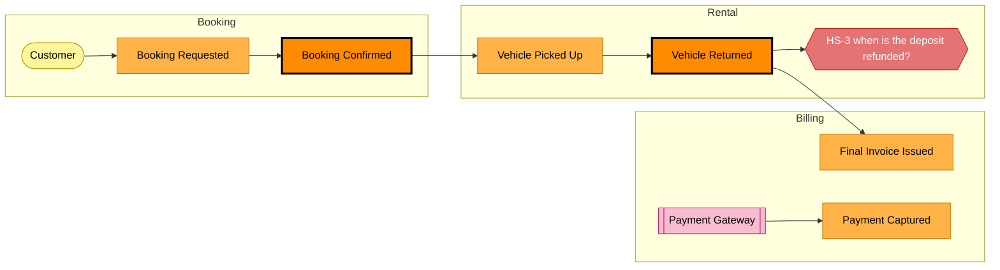

<!-- Tables, shell commands and output templates below run past 80 columns. -->
<!-- markdownlint-disable MD013 -->

# Ubiquitous Language Discovery

Derive a project's ubiquitous language (UL) from existing artifacts by running a
**virtual Big Picture EventStorming** (Brandolini, _Introducing EventStorming_:
"Running a Big Picture Workshop" and "Discovering Bounded Contexts with
EventStorming"). You are the facilitator. Each source is a workshop participant
with its own partial, biased view of the business. The user is the domain expert
in the room who settles what the sources can't.

## Why this approach

A glossary written by reading code top-down reproduces the code's vocabulary —
table names, CRUD verbs, status integers — which is the technical language the
UL is meant to replace (Khononov, _Learning DDD_, ch. 2). Domain events are a
better entry point: everyone understands them, they're precise enough to remove
ambiguity, and they expose behaviour, not just nouns. Putting them on one
timeline forces the inconsistencies between sources to the surface, and those
inconsistencies are where the real language decisions are. The glossary is the
by-product of resolving them.

Two of Brandolini's facilitation patterns shape how you work:

- **Fuzzy first, precise later.** Don't force agreement on words while
  harvesting. Divergent wording ("Schedule Ready" vs. "Schedule Published") is
  a clue — maybe two events, maybe two contexts. Keep both until the timeline
  makes you decide.
- **Guess first.** Don't ask the user an open question you could have guessed
  at. Propose your best interpretation with its evidence and let them correct
  it. Experts correct a wrong guess in seconds, but they answer open questions
  slowly and skip what they consider obvious.

## The rules you're enforcing

- **One term, one meaning within a context.** A homonym (same word, different
  meanings — "policy" as insurance contract vs. regulatory rule; "lead" in
  marketing vs. sales) gets split into two terms, or it's a sign of two bounded
  contexts. Don't average the meanings.
- **No synonyms within a context.** "Client / customer / account / user" used
  interchangeably often hides distinct roles; check before merging.
- **Business language, not implementation language.** "A campaign can be
  published only if it has a row in active_placements" is not UL; "a campaign
  can be published only once it has at least one placement" is.
- **Behaviour matters as much as nouns.** Glossaries are weak at behaviour, so
  record rules and invariants next to each term and keep the event timeline
  alongside the glossary.
- **Every term carries evidence** (`path:line`, doc section, or
  `user, <date>`) so the language stays auditable and a later session can resume.

## Workflow

Use a task list for the phases if one is available. Phases 1–3 are mostly you
working on the sources; Checkpoint A, Phases 4–6 and Checkpoint B are where the
user's input matters.

### Phase 0 — Kick-off

1. **Inventory the sources**: code modules, schemas/migrations, docs,
   manuals, tickets, i18n files. Note roughly how big each is. For a large
   codebase, run a quick harvest (see "Harvesting a large codebase" below)
   to get a map before reading files.
2. **Ask the user, in one batch** (AskUserQuestion if available; at most 4
   questions, each with a recommended option first):
   - **Scope**: the whole domain or one flow? Where does the story start and
     end?
   - **Canonical language** when sources mix languages (e.g. Italian manual,
     English code): English canonical terms with an original-language column
     (works best with code), source language only, or both.
   - **Who speaks for whom**: which sources reflect which roles ("the manual is
     what operators see; the code is what developers assumed")? Should one
     source win conflicts, or should every conflict become a hot spot?
   - Where the output files should go, only if the repo has no obvious docs
     folder; otherwise default to `docs/ubiquitous-language/`.
3. If nobody can answer (unattended run, or "just do it"), use the defaults —
   whole domain, English canonical terms plus an original-language column, no
   source wins automatically — state them at the top of the glossary, and go on.

### Phase 1 — Chaotic exploration: harvest, don't merge

Treat each source as a separate participant. Harvest **candidate domain
events** (business-relevant facts in past tense: "Booking Confirmed", "Vehicle
Returned Late") and the **nouns, roles and rules** around them. Work source by
source and keep each sticky's provenance. See "Mining each kind of source"
below for the heuristics.

- Rephrase into past-tense business wording, keeping the original identifier
  attached: `status = 3 (CLOSED)` → "Rental Closed?" `[RentalService.java:88]`.
- Phase names aren't events ("Registration", "Checkout", "Return process").
  They hide detail; break them into the events they're made of.
- Keep duplicates and near-duplicates from different sources. Don't resolve
  them yet.

**Side findings.** Reading code for its language, you'll trip over defects:
missing guards on transitions, race conditions, a late callback reviving a
cancelled record, unused or contradictory fields, rules applied to the wrong
party. They aren't language, so don't let them crowd the glossary, but don't
throw them away either: note each one in one line, with `path:line`, in the
**Side findings** section of `hotspots.md`. Developers refactoring toward the
new language need exactly this list, and it costs nothing to keep.

### Phase 2 — Enforce the timeline

Order the events into one flow from the scope's start to its end.

- Mark 3–6 **pivotal events**: transitions where the business changes focus
  ("Ticket Sold", "Conference Started"). They structure the timeline and are
  the first clue to context boundaries.
- Use **swimlanes** where flows run in parallel or on different clocks
  (billing vs. fulfilment; invited vs. submitting speakers).
- Merge duplicates only where the sources clearly describe the same fact.
  Where wordings differ and you aren't sure, keep both and raise a hot spot.
- Raise a **hot spot** (taxonomy below) wherever the timeline doesn't fit
  together.

### Phase 3 — People and systems

Add who triggers or cares about each part of the flow, and which external
systems take part. Actors come from manual roles, security roles and
permissions, user types in schemas. Systems come from HTTP clients, queues,
file imports/exports, SDKs, and outside parties ("the bank", "the
regulator"). A role that behaves differently in different parts of the flow
(the same "customer" as booker, driver and payer) is a language finding.
Record it.

### Checkpoint A — show the board, ask the hottest questions

Write the draft files (see "Output files") and present to the user:

- a 5–10 line narrative of the timeline,
- the pivotal events and swimlanes,
- the **3–4 most consequential hot spots** as guess-first questions.

Lead with the most consequential ambiguity, usually the central homonym
the user mentioned or the overloaded concept everything hangs on. Don't
decide it silently even when the evidence looks clear: propose the split as
your guess and let the expert confirm it. Prioritise questions whose answer
changes the model (a homonym that might split a context, code contradicting
the manual, a missing step that breaks the flow) over cosmetic naming. Ask in
the domain's language, never the code's: "When a rental is _closed_, has the
car been returned, paid for, or both?", not "What does status 3 mean?". Give
the evidence for your guess in one line.

Record each answer in the hot-spot log straight away, with the date and who
decided, so a later session can pick up where you stopped.

### Phase 4 — Explicit walk-through

Narrate the whole story left to right using only candidate UL terms, the way a
narrator walks the wall. Speaking the story exposes gaps that reading misses:
whenever the narrative needs a word that isn't on the board, uses two words for
one thing, or jumps ("…and then the invoice is sent": sent by whom, after
what?), add the event or raise a hot spot. Show the narrative to the user and
invite them to interrupt. This is the main validation step.

### Phase 5 — Reverse narrative

Start from terminal and pivotal events and walk backwards: "What must have
happened for _Deposit Refunded_ to be possible?" Brandolini reports this
typically surfaces 30–40% of the flow that optimistic forward thinking buried.
Look especially at the money flow (payments, invoices, refunds, penalties),
which developer-written sources routinely skip. Check it concretely: for
every amount the sources compute or mention (price, fee, deposit, invoice,
refund), find the event where it is actually paid or collected and the party
who pays it. If no source shows that event, it's a `GAP`. Do the same for each
role a party can play (e.g. an agency that is both the one booking and the
one billed): follow each rule that targets the party (blocks, notifications,
invoices) and check that it lands on the right one. Add events, raise hot
spots, and ask the user about gaps no source can fill.

### Phase 6 — Consolidate the language

Now apply precision. For each concept decide:

- the canonical term and a one- or two-sentence definition in business
  language, plus the rules and invariants that give it meaning,
- the context it belongs to, once contexts are emerging,
- the synonyms, translations and code aliases to retire,
- its status: **✅ agreed** (confirmed by the user, or consistent across
  independent sources), **🟡 proposed** (your inference, unconfirmed), or
  **🔴 disputed** (an open hot spot).

Resolve homonyms by splitting terms or contexts, and synonyms by choosing one
term per context. Ask the user about remaining disputed terms that are central
to the domain; leave peripheral ones as open hot spots rather than interrogating
them about everything.

Keep the glossary short enough to read in one sitting. Most classes and tables
are implementation, not language.

### Phase 7 — Candidate bounded contexts

Propose boundaries from Brandolini's heuristics: pivotal events, swimlanes,
places where the same word changes meaning, different actors caring about
different parts of the flow, and different source "owners". They're
candidates: say what evidence supports each and what would change your mind.
Keep it to a short table; a full context map is out of scope.

### Optional — design-level deepening

Only when the user asks, or the scope is one flow they want to implement, go
to process/design level for the chosen area:

- **Commands** (imperative, blue): what an actor or system asks for.
- **Policies** (lilac): "Whenever _event_, then _command_". There's always a
  business decision between an event and its reaction; name it.
- **Read models** (green): what the actor looks at to decide.
- **Aggregate candidates** (pale yellow): what accepts the commands, protects
  the rules and emits the events.

Put this in its own section of the board file. It often renames events again;
that's expected ("the obsession with naming and rewriting is so DDD").

### Checkpoint B — final review and delivery

Write the final files, then tell the user: what came out (agreed / proposed /
disputed counts, candidate contexts), the 3–5 most important language findings
(e.g. "'Order' means three things across sales, warehouse and billing"),
the open hot spots that still need an expert, and a one-line pointer to the
side findings if there are any. Add one next step if there's a
real one, such as a short real workshop with the people behind the disputed
terms, or renaming the code aliases in one module.

## When the user can't be asked

If the run is unattended or the user says "just do it", follow the same phases,
take the most plausible reading at each decision, mark those terms
**proposed**, and put every question you would have asked into the hot-spot log
as an open question with your guess. Log the kick-off defaults as working
assumptions, not decisions, and keep the checkpoint batches intact so the
user can answer them in order when they return. Don't present an inference
as an agreed term.

## Hot-spot taxonomy

| Tag             | Meaning                                                   | Example                                                             |
| --------------- | --------------------------------------------------------- | ------------------------------------------------------------------- |
| `HOMONYM`       | Same word, different meanings                             | "Order" = customer purchase in sales, pick list in warehouse        |
| `SYNONYM`       | Different words, maybe the same concept                   | Customer / Client / Account                                         |
| `DRIFT`         | Code and docs or manual disagree                          | Manual: deposit refunded at return; code: refunded by a nightly job |
| `GAP`           | The story jumps; a step must exist but no source shows it | Invoice sent, but nothing creates the invoice                       |
| `TECH-LEAK`     | Only technical vocabulary exists for a business concept   | `flag_x = 2`, `tbl_ord_det`                                         |
| `IMPLICIT-RULE` | A business rule hidden in code, named nowhere             | `if (km > 300) surcharge`                                           |
| `CONTRADICTION` | Two non-code sources disagree                             | Two manuals describe different approval steps                       |

## Mining each kind of source

Know each participant's bias so you weigh what it says correctly:

| Source                        | Knows well                                      | Typical bias                                                 |
| ----------------------------- | ----------------------------------------------- | ------------------------------------------------------------ |
| Code                          | What actually happens, edge cases, hidden rules | Technical vocabulary, CRUD verbs, developer guesses at names |
| DB schema / migrations        | Which facts are remembered, when                | Table-speak, legacy columns, merged concepts                 |
| Specs, wikis, ADRs            | Intended behaviour, rationale                   | Out of date; the "official version" of the process           |
| User manuals, help, UI labels | How users see and name things                   | Screen-centric; hides back-office steps                      |
| Tickets, support emails       | Where reality hurts; exceptions                 | Anecdotal, one-sided                                         |
| Interviews, meeting notes     | Experts' own words                              | Fragmentary, ambiguous                                       |

**Code that doesn't follow DDD** (CRUD services, anemic entities, transaction
scripts) rarely names its events. Look for **state changes** and **facts worth
remembering**:

- Status fields, enums and constants (`status`, `state`, `stage`,
  `STATUS_CLOSED = 3`). Each _transition_ is a candidate event; find where the
  field is set to learn the trigger and the guards.
- Timestamp fields and columns (`approved_at`, `shippedDate`,
  `last_reminder_sent`): the business wants to remember when this happened, so
  it's an event.
- Boolean flags (`is_paid`, `deposit_returned`, `blacklisted`): the moment the
  flag flips is an event, and the flag's name often hides a business term.
- Method names: `approve()`, `close()` are hints. Generic ones (`update`,
  `process`, `handle`, `save`) mean the intent is in the body; read it.
- Side effects: emails/SMS, generated documents (invoices, contracts),
  published messages, webhooks. Each usually follows an event and implies a
  policy.
- Scheduled jobs and batches: time-triggered events ("Payment Term Expired")
  and policies.
- Guards and validation (`if (...) throw`): business rules. Magic numbers
  (`> 300`, `< 25`) are rules missing a name → `IMPLICIT-RULE`.
- Security roles (`ROLE_OPERATOR`, `@PreAuthorize`, permission tables) →
  actors. HTTP clients, SDKs, file transfers, queues → external systems.
- Comments, log and exception messages, UI labels and i18n bundles
  (`messages_it.properties`) are usually closer to the business language than
  identifiers. Test names often describe business scenarios in plain words.
- One class or table doing several jobs (a `Contract` used for quote, booking
  and invoice) is the classic hidden homonym.
- Treat as noise unless proven otherwise: framework classes, `Dto` / `Request`
  / `Vo` suffixes, `Manager` / `Helper` / `Util`, generic CRUD endpoints, `id`,
  `created_by`, `version`.

**Schemas and migrations**: lookup tables (`order_status`, `claim_type`) list
business states directly. Columns filled only late in a lifecycle signal later
events. Renames in migrations show how the language drifted, sometimes
revealing old meanings users still use.

**Specs, wikis, ADRs**: use them to order the timeline, but don't trust them
over code for what actually happens; the documented flow and the real one
usually diverge (`DRIFT`). Rewrite "The system shall…" sentences as business
rules without "the system".

**Manuals and help pages**: procedure steps are commands; outcome sentences
("the booking is now confirmed") are events; notes and warnings ("a cancelled
booking can't be reactivated") are rules. Screen and field names are the users'
vocabulary. Manuals skip what users don't see (back office, batches, billing),
so expect `GAP`s there and fill them from code.

**Tickets, support emails, interviews**: complaints point where model and
reality diverge. Experts' own phrasing is the strongest candidate for canonical
terms; quote briefly and cite.

**Other languages**: when a source term is in another language than the
canonical one, keep the original next to it. Translation choices are language
decisions: two Italian words that both translate to "claim" ("sinistro",
"pratica") may mean different things. Ask rather than collapse them.

### Harvesting a large codebase

For more than a few dozen files, get a map before reading. Adapt the globs to
the stack; `rg` is faster but `grep -rnE` works too:

```bash
# status/state enums and constants → candidate states and events
rg -n --no-heading -e 'enum\s+\w*(Status|State|Stage|Phase|Type)\b' -e '\b[A-Z_]*(STATUS|STATE)_[A-Z_]+\s*=' <src>
# timestamp-like fields/columns → candidate events
rg -no --no-heading '\b[a-z]\w*(_at|_date|_on|At|Date)\b' <src> | sort | uniq -c | sort -rn | head -50
# boolean flags → hidden terms and events
rg -no --no-heading '\b(is|has|was)(_[a-z_]+|[A-Z]\w+)\b' <src> | sort | uniq -c | sort -rn | head -40
# roles → actors; outbound clients → external systems
rg -n --no-heading -e 'ROLE_\w+' -e 'has(Any)?Role\(' -e '(RestTemplate|WebClient|FeignClient|HttpClient|axios|fetch)\b' <src>
# schedulers, emails, documents → time-triggered events and policies
rg -n --no-heading -e '@Scheduled|cron|setInterval' -e '(send|mail|notify)\w*\(' -e '(pdf|invoice|contract)\w*\(' -i <src>
# user-facing words
rg --files <src> | rg -i '(messages.*\.properties|i18n|locales?/.*\.json|\.po)$'
```

Treat the hits as a map, not a glossary: read each in context before it
becomes a sticky.

## Output files

Default location `docs/ubiquitous-language/` in the project (or what the user
chose). Markdown next to the code keeps the language versioned and reviewable
in PRs. If the files already exist, update them in place: keep agreed terms and
decisions, add new findings, and log changes in `hotspots.md` instead of
silently rewriting definitions.

```text
docs/ubiquitous-language/
├── glossary.md              # the ubiquitous language
├── event-storming-board.md  # timeline, pivotal events, lanes, people & systems, contexts
└── hotspots.md              # open questions, decisions log, side findings
```

### glossary.md

```markdown
# Ubiquitous Language — <Domain>

Scope: <where the story starts and ends>
Canonical language: <e.g. English; original Italian terms under "Also known as">
Last updated: <date> · ✅ agreed · 🟡 proposed · 🔴 disputed

## <Context name> (candidate)

### Rental ✅

A customer's use of one vehicle for an agreed period, from pick-up to return.

- **Rules:** A rental can't start without a valid driving licence on file.
  Returning more than 2 h late adds a late-return fee.
- **Lifecycle:** Rental Started → Vehicle Returned → Rental Closed
- **Also known as:** "Noleggio" (operator manual) · `Contract`, `rent_order` (code — retire)
- **Not to be confused with:** _Booking_, the reservation before pick-up
- **Evidence:** `RentalService.java:42-88`, manual §3.2, user 2026-11-17

## Actors

## External systems

## Retired / avoided terms

| Term | Use instead | Why |
```

Definitions in business language (no "entity", "table", "FK", "DTO").
"Not to be confused with" is where homonym decisions live. The retired-terms
table is often what developers use most when renaming code.

### event-storming-board.md

A Mermaid diagram for the eye and a table for precision and diffs. Colours
follow the EventStorming legend.

````markdown
# Big Picture board — <Domain>

Legend: 🟧 event · ⭐ pivotal event · 🟨 actor · 🟪 external system · 🟥 hot spot



## Events

| #   | Event | Lane | Pivotal | Triggered by | Evidence | Hot spots |
| --- | ----- | ---- | ------- | ------------ | -------- | --------- |

## People and systems

## Candidate bounded contexts

| Context | Owns terms | Boundary evidence | Confidence |

## Design level (only if requested)
````

With more than ~30 events, draw one diagram per lane and keep the full list in
the table.

### hotspots.md

```markdown
# Hot spots & decisions — <Domain>

## Open

### HS-3 `DRIFT` — When is the deposit refunded?

- Manual §4.1: refunded at the counter when the car is returned.
- Code `DepositJob.java:20`: refunded by a nightly job 3 days after return if there's no damage report.
- **Guess:** two events — _Deposit Release Scheduled_ at return, _Deposit Refunded_ by the job.
- **Question for the expert:** Is the 3-day wait a business rule (window for damage claims) or a technical workaround?
- Impacts: Rental, Billing

## Decided

### HS-1 `SYNONYM` — Customer vs Client vs Driver — 2026-11-17, decided by <user>

- _Customer_ = who books and pays; _Driver_ = who drives (may differ). "Client" retired.

## Side findings (not language — for the developers)

| #    | Finding                                                                                | Where                                        | Why it matters                        |
| ---- | -------------------------------------------------------------------------------------- | -------------------------------------------- | ------------------------------------- |
| SF-1 | Any status can be set through the generic status endpoint, skipping pick-up and return | `ContractController.java:16-20`              | Rental can be closed without a return |
| SF-2 | Deposit is never released after a damage case                                          | `ContractController.java:34-38` (empty TODO) | Money held indefinitely               |
```

Every hot spot has an ID, a tag, the conflicting evidence, a guess, the
question in domain language, and what it impacts. Side findings stay one line
each; they're a checklist, not an analysis.

## Anti-patterns

- A glossary entry for every class and table.
- Silently picking a winner between conflicting sources. Conflicts are the
  most valuable output; surface them.
- Asking 20 questions at once, or one question per turn for 20 turns. Batch at
  the checkpoints, 3–4 per batch, highest impact first.
- Technical wording in definitions or questions.
- Jumping to aggregates and context maps before the language is agreed.
